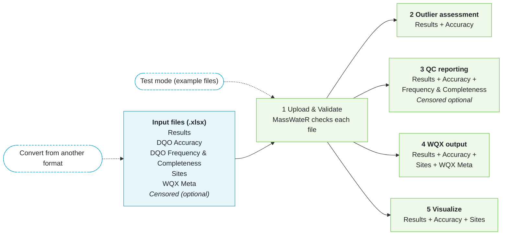

# MassWateRdash

Materials for a MassWateR Shiny dashboard

## Using the Dashboard

There are three ways to run the dashboard, depending on whether you want to simply access it from a web browser, use (or develop) the app locally, or install it as a package.

### Web browser

The app is currently deployed at <https://masswater.app>. Simply navigate to the URL to begin using the app. The online version uses a pre-built Docker image. See [`docker/DEPLOY.md`](docker/DEPLOY.md) for details on how the app was deployed.

### Local development (git clone + devtools)

Clone the repo and run the app from source with [devtools](https://devtools.r-lib.org/):

```r
# clone the repo, then from within the MassWateRdash directory:
devtools::load_all()
shiny::runApp()
```

This is the workflow to use if you're running the app within an IDE (e.g., RStudio).

### Package install (remotes::install_github)

To use the dashboard without cloning the repo, install it directly as a package.  This is also done locally within an IDE (e.g., RStudio):

```r
remotes::install_github("massbays-tech/MassWateRdash")
library(MassWateRdash)
run_app()
```

## Workflow

This diagram shows which input files are needed to populate each tab of the dashboard. All files are uploaded on the **Upload & Validate** tab, where they are checked by MassWateR. Each tab appears in the navigation bar once its required files have been uploaded and validated. Files can also be converted from another format before upload, or the example files can be loaded with test mode.



Each tab box lists the files it needs. Dashed boxes and arrows are optional. The DQO Accuracy file is needed for every tab because MassWateR uses its quantitation limits to fill in results reported below detection or above quantitation. The Sites file provides the site coordinates and location groups used by the WQX output and the Visualize plots and map.
